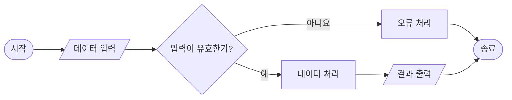
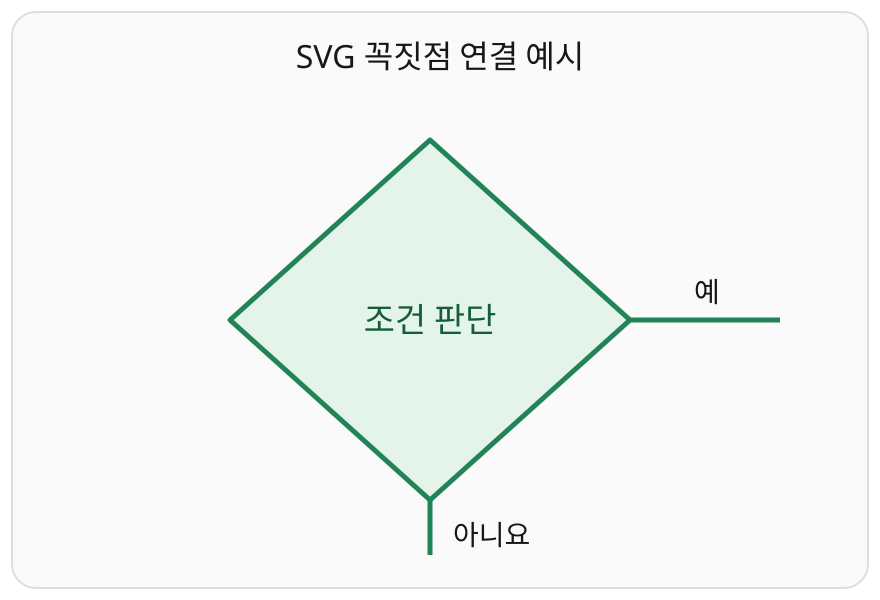

# 📐 플로우차트·구조도·기술 도식 작성 표준 v1.0

**적용 범위:** 모든 웹페이지·HTML 교재·Notion·GitHub 문서·C/Python 프로그램·RTL/FPGA/SoC·전기전자 기술자료  
**기본 원칙:** 정확성 → 논리적 흐름 → 가독성 → 시각적 완성도  
**상위 규칙:** [범용 웹페이지 제작 표준](../web/YJWS_v1.0.md)

> 이 문서는 기존 「플로우차트·구조도 작성 표준 규칙」의 10개 항목을 보존·구체화한 공통 표준이다. 아래의 정량적인 수치와 도식별 추가 기준은 품질을 높이기 위한 **권장 기준**이며, 원본 코드·기술 명세와 충돌하면 실제 동작을 우선한다.

## 1. 도식 작성 목적과 정확성

1. 단순한 장식이 아니라 **실제 설계·코드·알고리즘·하드웨어 동작을 전달하는 기술 자료**로 작성한다.
2. 도식만 보고 입력, 처리, 판단, 출력, 종료 및 예외 경로를 파악할 수 있어야 한다.
3. 실제 구현을 표현하는 **구현 도식**과 이해를 돕는 **개념 도식**을 명시적으로 구분한다.
4. 존재하지 않는 모듈·신호·함수·상태를 임의로 추가하지 않는다. 추상화한 요소는 ‘개념적 구성’이라고 표시한다.
5. 도식이 정확하더라도 글자·선이 겹치거나 흐름이 불명확하면 배포하지 않는다.

## 2. 도식 종류 선택

| 종류 | 주요 목적 | 배치·표현 원칙 |
|---|---|---|
| 플로우차트(Flowchart, 절차 흐름도) | 함수·알고리즘·분기·반복 | 기본 좌→우, `flowchart LR` |
| 블록 다이어그램(Block Diagram, 기능 블록도) | 하드웨어·소프트웨어 구성 | 입력 왼쪽, 출력 오른쪽 |
| 아키텍처 다이어그램(Architecture Diagram, 시스템 구조도) | 시스템 계층과 구성요소 관계 | 계층은 상→하 또는 좌→우 |
| 상태도(State Diagram, 상태 전이도) | FSM(유한상태머신) 상태와 전이 | 상태·전이 조건·복귀 경로 |
| 시퀀스 다이어그램(Sequence Diagram, 상호작용 순서도) | 모듈 호출·통신 메시지 순서 | 시간은 위→아래 |
| 타이밍 다이어그램(Timing Diagram, 시간 관계도) | 클록·신호·지연·핸드셰이크 | 시간은 왼쪽→오른쪽 |
| 데이터 흐름도(Data Flow Diagram, 데이터 이동도) | 데이터 생산·변환·저장 | 데이터 방향과 저장소 구분 |

서로 다른 도식 종류를 무리하게 한 장에 섞지 않는다. 전체 구성도와 세부 동작도는 분리한다.

## 3. 표준 도형과 의미

| 도형 | 용도 | 주의사항 |
|---|---|---|
| 둥근 사각형·타원 | 시작·종료 | 처리 단계와 혼동하지 않는다 |
| 사각형 | 처리·연산·함수 실행·기능 블록 | 동작을 동사 중심으로 표기 |
| 마름모 | 조건 판단·분기 | 실제 조건과 분기 결과를 표시 |
| 평행사변형 | 입력·출력 | 데이터의 출처·대상 구분 |
| 원통 | 데이터베이스·저장소 | 일반 처리에 남용하지 않는다 |
| 그룹 박스 | 같은 시스템·계층·기능 묶음 | 그룹 경계와 연결 방향을 명확히 |

- 조건 판단은 가능하면 **예/아니요**, **참/거짓**, 또는 실제 조건값을 화살표 옆에 표기한다.
- 분기 조건이 3개 이상이면 각 경로를 명시하고, 필요하면 별도의 조건표를 추가한다.
- 함수 호출·레지스터 쓰기·상태 갱신은 처리 도형으로 표현하고, 실제 판단이 있을 때만 마름모를 사용한다.
- 종료 경로가 여러 개라면 정상 종료·오류 종료를 구분한다.

## 4. 배치·연결선·화살표

1. 주 흐름은 한 방향(기본 좌→우)으로 유지한다.
2. 입력은 왼쪽, 출력은 오른쪽에 배치하고, 반복·오류 경로는 주 흐름의 바깥쪽으로 우회한다.
3. 연결선은 도형·문자·다른 연결선을 가급적 관통하지 않는다.
4. 교차가 불가피하면 경로를 재배치하거나 도식을 분리한다.
5. 화살표는 실제 데이터·제어·상태 전이 방향과 일치해야 한다.
6. 양방향 통신은 송신·수신을 구별해 표시하고, 필요하면 화살표 두 개로 나눈다.
7. 고아 노드(연결되지 않은 도형), 의미 없는 화살표, 출처 없는 데이터 흐름을 제거한다.
8. 합류점에서는 어떤 경로가 합류하는지 확인하고, 반복 경로는 올바른 조건 검사 지점으로 돌아가야 한다.
9. 데이터 흐름과 제어 흐름이 복잡하게 교차하면 별도 도식으로 분리한다.

**권장 배치:** 비슷한 크기의 도형과 균등한 간격을 사용하되, 선 겹침 방지를 위해 필요한 경우 간격을 넓힌다. 일정한 수치보다 **충돌 없는 읽기 흐름**을 우선한다.

## 5. 실제 코드와 명칭 일치

- C/Python: 실제 함수명, 호출 순서, `if`/`else` 조건, 반복문, 반환값, 오류 처리와 일치시킨다.
- RTL/Verilog: 실제 모듈명, 포트명, 신호명, 상태명, `always` 블록의 분기·우선순위와 일치시킨다.
- UART/통신: 실제 수신 단위(바이트·문자열·프레임), 종료 문자, 명령 문자열, 응답, 오류 처리를 그대로 반영한다.
- 레지스터 맵: 실제 주소·비트 필드·읽기/쓰기 방향·갱신 시점을 확인한다.
- 도식 라벨은 **`실제_코드명` + 쉬운 한글 설명**을 기본으로 한다. 예: `rx_valid` (수신 데이터 유효).
- 실제 코드가 없는 경우 ‘설계안’, ‘예시’, ‘개념도’ 중 적절한 상태를 표기한다.

### 5.1 코드→도식 추적표

| 확인 대상 | 코드에서 추출할 것 | 도식에서 검증할 것 |
|---|---|---|
| 시작·종료 | 진입 함수·종료/반환 | 시작·종료 노드 |
| 분기 | 실제 조건식·우선순위 | 마름모·분기 라벨 |
| 반복 | 루프 조건·복귀 지점 | 반복 화살표·탈출 경로 |
| 함수 호출 | 함수명·호출 위치 | 처리 노드와 호출 순서 |
| 입출력 | 실제 변수·포트·레지스터 | 입력·출력 도형 및 방향 |
| 예외 | 오류 코드·타임아웃·기본 분기 | 오류 경로·복구·종료 |

도식을 먼저 그렸더라도 최종 배포 전에는 **소스에서 도식으로 역추적**해 빠진 분기를 확인한다.

## 6. 가독성·색상·문자

1. 동일한 의미의 노드는 동일한 모양·색상·선 스타일을 사용한다.
2. 색상은 입력·처리·판단·출력·오류 등 **기능 구분**에만 사용한다.
3. 색상만으로 의미를 전달하지 않고 라벨·도형·선 스타일을 병용한다.
4. 한 도형의 라벨은 가급적 1~2줄로 유지하고 긴 설명은 그림 아래로 옮긴다.
5. 글자는 화면 확대 없이 읽을 수 있도록 충분히 크게 배치한다.
6. 밝은 테마와 어두운 테마에서 대비를 확인한다.
7. 지나친 그라데이션, 그림자, 입체 효과, 장식 아이콘을 피한다.
8. 선 끝의 화살촉, 분기 라벨, 그룹 제목이 다른 요소와 겹치지 않아야 한다.
9. 긴 도식은 모바일에서 가로 스크롤·확대 또는 단계별 분할을 제공한다.

**권장 시작값:** 일반 웹 본문 도식은 글자 크기 약 14~16 CSS 픽셀, 작은 보조 라벨도 가급적 12픽셀 이상으로 설계한다. 이 수치는 화면·인쇄·밀도에 따라 조정한다.

## 7. 복잡한 도식의 분할

- 전체 아키텍처 → 하위 모듈 구조 → 세부 처리 흐름의 **3단계 확대 방식**을 우선한다.
- 노드 수가 많아 한 화면에서 읽기 어렵다면 기능별로 분리한다.
- 데이터 경로, 제어 경로, 인터럽트·오류 경로는 필요에 따라 따로 그린다.
- 생략한 신호·상태·시간 구간은 ‘생략’이라고 명시하고 생략 범위를 설명한다.
- 여러 그림에 걸쳐 동일한 모듈을 표현할 때는 명칭·색상·방향을 일관되게 유지한다.
- 한 장의 그림으로 전체 내용을 억지로 해결하지 않는다.

## 8. 도식별 추가 규칙

### 8.1 프로그램 플로우차트

- 실제 함수 단위로 그리며 시작→입력→처리→판단→출력→종료를 확인한다.
- 모든 필수 분기와 반복 탈출 조건을 표시한다.
- 오류 처리와 타임아웃이 실제 코드에 있으면 누락하지 않는다.
- **예시**: 문자열 명령 처리에서 실제 명령이 `LED ON`, `LED OFF`, `STATUS`라면 그 문자열을 그대로 표기한다. 이 문자열은 MBV SoC 과제 예시이지 모든 프로그램의 공통 명령이 아니다.

### 8.2 RTL·FSM 상태도

- 실제 `localparam` 또는 `parameter` 상태 이름을 사용한다.
- 전이 조건, 초기 상태, 리셋 시 복귀 상태, 유효하지 않은 상태 처리 방식을 확인한다.
- 순차 논리의 레지스터 갱신 시점과 조합 논리의 조건 판단을 혼동하지 않는다.
- 상태 전이와 데이터 경로가 복잡하면 별도 그림으로 나눈다.

### 8.3 하드웨어 블록도

- 외부 보드 핀과 내부 신호를 구분한다.
- 클록·리셋·데이터·제어·인터럽트를 필요에 따라 다른 선 스타일이나 라벨로 구분한다.
- 버스 폭, 주소, 방향, 동기화 경계를 실제 설계에 맞춰 표기한다.
- 블록 간 신호 이름이 실제 포트 연결과 일치하는지 검증한다.

### 8.4 타이밍 다이어그램

- 시간축과 클록 기준을 명시한다.
- 상승·하강 에지, 샘플링 시점, 유효 데이터 구간, 핸드셰이크 조건을 실제 구현에 맞춘다.
- 교육용 압축 시간축을 사용하면 **실제 시간과 그림 단위의 환산 관계**를 명시한다.
- 생략 구간은 `...` 등으로 표시하고, 생략 때문에 순서·인과관계가 왜곡되지 않도록 한다.
- 시뮬레이션 파형과 개념적 파형을 구분한다.

## 9. 작성 도구·출력 형식

| 대상 | 기본 형식 | 필수 확인 |
|---|---|---|
| Notion·GitHub Markdown | Mermaid 원본 | 해당 환경의 문법·렌더링 호환 |
| HTML 기술 교재 | SVG 벡터 도식 | 반응형·테마·문자·선 겹침 |
| 수정·재사용이 필요한 그림 | Mermaid 또는 편집 가능한 SVG 원본 | 원본 파일 보존 |
| 시간 관계 설명 | 타이밍 전용 도식 | 실제 시간·압축 단위 표기 |
| 대화창 | 렌더링 가능한 도식 | 가독성과 기술 정합성 |

Mermaid 가로형 기본 예시는 다음과 같다.

**주의:** 위 그림은 도형·분기 표기법을 설명하는 **개념 예시**이며, 특정 실제 프로그램의 실행 흐름을 검증한 그림이 아니다.

## 10. HTML·SVG 제작 세부 기준

- SVG에는 의미 있는 `viewBox`를 지정해 확대·축소에 대응한다.
- 텍스트가 도형 밖으로 잘리지 않도록 라벨 폭·줄바꿈·여백을 검토한다.
- HTML에서 도식의 의미를 설명하는 대체 텍스트 또는 인접 설명을 제공한다.
- 밝은/어두운 테마 모두에서 글자·선·배경 대비를 확인한다.
- 도식이 가로로 길면 확대 보기나 가로 스크롤을 제공하되 기본 화면에서 핵심 구조를 읽을 수 있도록 한다.
- 배포용 SVG와 편집 가능한 원본의 의미가 일치하도록 관리한다.
- 외부 폰트나 불필요한 이미지 의존성을 최소화한다.

## 11. 필수 적대적 검증 체크리스트

### 11.1 기술·논리 검증
- [ ] 시작·종료 또는 입력·출력 관계가 명확하다.
- [ ] 실제 설계·코드·알고리즘과 일치한다.
- [ ] 실제 코드에 없는 신호·모듈·함수를 사실처럼 넣지 않았다.
- [ ] 조건 분기의 필요한 모든 경로를 표현했다.
- [ ] 반복 경로와 종료 조건이 정확하다.
- [ ] 화살표 방향·버스 방향·상태 전이가 정확하다.
- [ ] 데이터·제어·클록·리셋의 의미를 혼동하지 않았다.
- [ ] 명령 문자열·레지스터 주소·신호명이 코드와 일치한다.

### 11.2 화면·표현 검증
- [ ] 문자와 도형·연결선이 겹치지 않는다.
- [ ] 화살표 끝과 분기 라벨이 가려지지 않는다.
- [ ] 같은 기능의 도형·색상·명칭이 일관된다.
- [ ] 데스크톱과 모바일에서 읽을 수 있다.
- [ ] 밝은/어두운 테마에서 대비가 충분하다.
- [ ] 의도적 생략 구간을 설명했다.
- [ ] 실제 배포 환경에서 렌더링했다.

### 11.3 배포·유지보수 검증
- [ ] Mermaid/SVG 원본을 보존했다.
- [ ] 링크·삽입 경로가 정상이다.
- [ ] 공개하면 안 되는 정보가 없다.
- [ ] 변경 시 코드·본문·도식을 함께 검토했다.
- [ ] 미실행 검증을 ‘통과’로 표시하지 않았다.

## 12. 검증 판정과 수정 원칙

| 판정 | 의미 |
|---|---|
| 통과 | 해당 항목을 실제로 확인했고 기준을 충족 |
| 실패 | 오류 또는 기준 미달 확인 |
| 미검증 | 확인하지 않았거나 확인할 수 없음 |
| 해당 없음 | 해당 도식에 적용할 수 없는 항목 |

- 오류가 확인되면 **원인 분석 → 최소 수정 → 재렌더링 → 재검증** 순으로 처리한다.
- 실제 코드와 그림이 다르면 **검증된 코드·명세를 기준으로** 그림을 정정한다.
- 코드가 정확하고 기존 도식도 의미가 맞다면 불필요하게 전면 재작성하지 않는다.
- 자동 검증만으로 시각적 충돌이 모두 해결되었다고 단정하지 않는다.
- 실제 렌더링을 확인하지 못했다면 시각적 검증은 ‘미검증’으로 남긴다.

## 13. 최종 제작 절차

**구조 분석 → 도식 종류 결정 → 코드·명세 추출 → 노드·분기·연결 정의 → 배치 최적화 → 코드 정합성 검증 → 실제 렌더링 확인 → 적대적 검증 → 배포**

최종 결과는 **정확하고, 읽기 쉬우며, 수정 가능하고, 재사용할 수 있는 기술 도식**이어야 한다.

## 14. 마름모 꼭짓점 연결 및 고품질 SVG 배치 기준

- **최종 배포용 기술 플로우차트는 SVG를 우선**한다. Mermaid는 초안·편집용으로 사용할 수 있으나 자동 배치 결과를 무조건 최종본으로 채택하지 않는다.
- 판단 마름모의 기본 연결점은 **상·하·좌·우 네 꼭짓점**이다. 도형 변 중간에 임의로 연결하는 방식은 기본 표준으로 사용하지 않는다.
- 주 흐름의 진입·진출 방향을 일관되게 유지한다. 예를 들어 좌측에서 진입한 판단은 오른쪽(예), 아래쪽(아니요)으로 분기할 수 있다. 실제 코드 조건에 맞게 방향과 라벨을 결정한다.
- 연결선은 가급적 수평·수직 직각 경로로 구성하며, 선이 마름모 내부·문자·다른 노드를 가로지르지 않도록 한다.
- 예/아니요·참/거짓 라벨은 각 화살표의 시작 부근 또는 충돌 없는 명확한 위치에 둔다.
- 여러 분기나 복잡한 역방향 경로 때문에 꼭짓점 연결이 오히려 혼란을 일으키면 예외를 허용하되, **가독성·코드 정합성**을 우선한다.
- SVG 제작 시 마름모의 실제 꼭짓점 좌표와 연결선 시작 좌표가 정확히 일치하는지 확인한다. 화살표 끝은 다음 노드 경계에서 끝나도록 하고 도형을 관통하지 않는다.
- 글자·화살표·도형 간 겹침을 제거하고, 실제 HTML 렌더링으로 검증한다. 단순히 SVG 코드가 생성되었다는 이유로 시각적 검증을 통과 처리하지 않는다.
- 낮에 사용한 **도형과 선 위치를 직접 제어하는 SVG 방식**을 품질 기준으로 삼는다. 해당 샘플을 재현할 때는 실제 샘플 원본과 대조하고 추정으로 동일하다고 주장하지 않는다.

### 14.1 실제 SVG 예제 및 좌표 검증

- [편집 가능한 SVG 원본](examples/diamond-vertex.svg)
- 마름모 꼭짓점: 위 `(430,140)`, 오른쪽 `(630,320)`, 아래 `(430,500)`, 왼쪽 `(230,320)`.
- ‘예’ 연결선은 오른쪽 꼭짓점 `(630,320)`에서 시작하고, ‘아니요’ 연결선은 아래쪽 꼭짓점 `(430,500)`에서 시작한다.
- 예제의 선은 **연결 위치 설명용**이므로 후속 노드와 화살촉은 생략하였다. 실제 플로우차트에서는 다음 노드까지 연결하고 방향을 표시한다.
- SVG XML 구문 및 좌표 일치 검사는 가능하지만, 브라우저별 실제 시각적 렌더링 검사는 별도로 수행한다.
